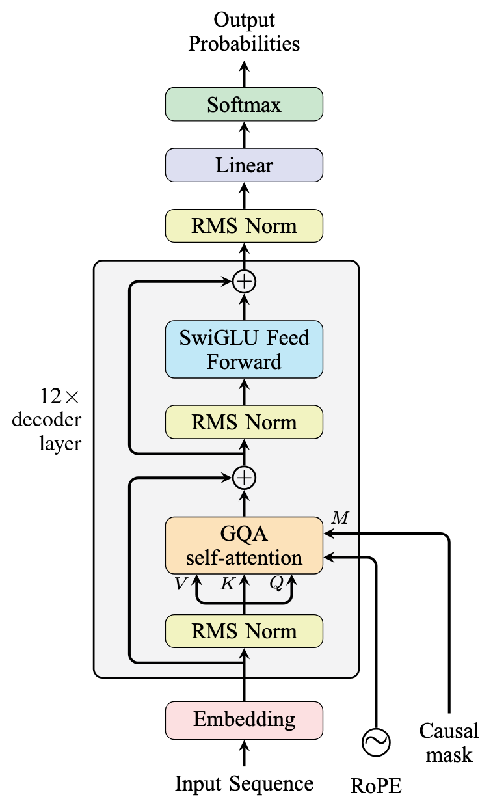
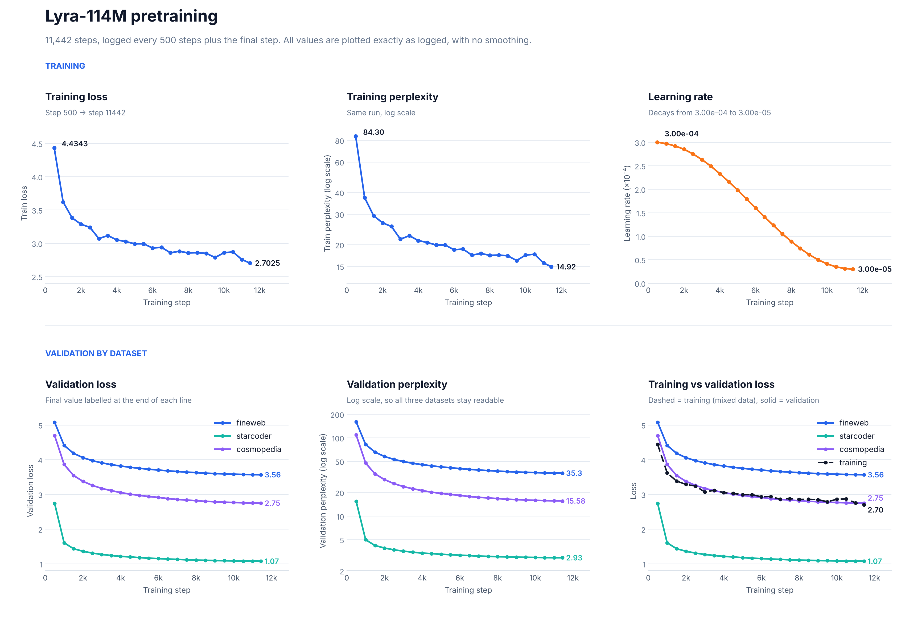
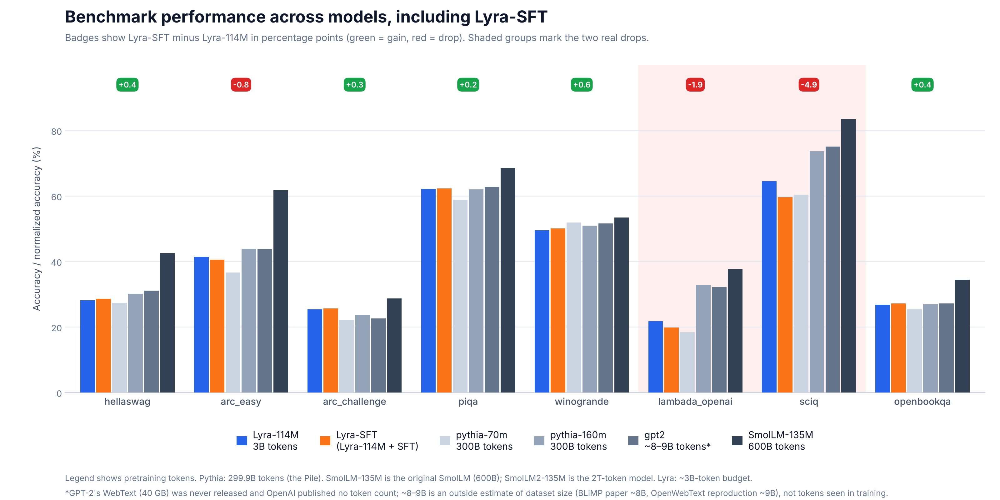
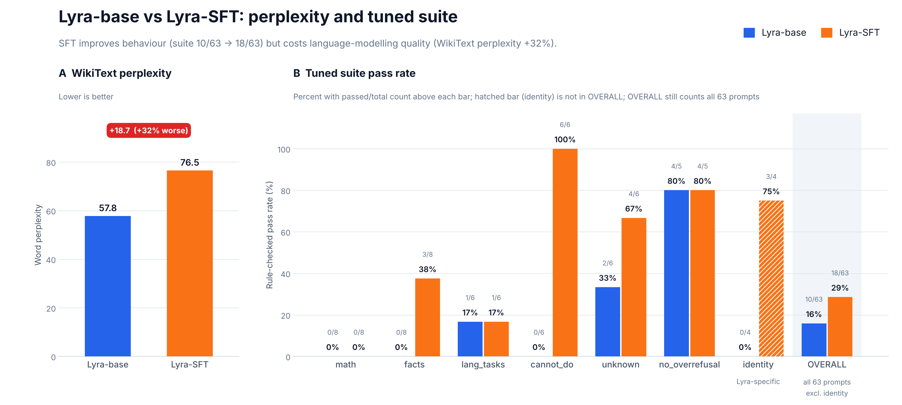

# Lyra: Building a Language Model from Scratch

An experimental decoder-only Transformer language model developed using PyTorch, exploring modern architecture design, attention optimisation, pretraining, and supervised fine-tuning.

---

## Table of Contents

1. [Introduction](#1-introduction)
2. [Model Architecture](#2-model-architecture)
3. [Attention Implementation and Optimisation](#3-attention-implementation-and-optimisation)
4. [Pretraining Dataset and Data Processing](#4-pretraining-dataset-and-data-processing)
5. [Pretraining Configuration](#5-pretraining-configuration)
6. [Pretraining Results](#6-pretraining-results)
7. [Supervised Fine-Tuning](#7-supervised-fine-tuning)
8. [Evaluation and Results](#8-evaluation-and-results)
9. [Alignment Tax and Post-Training Trade-offs](#9-alignment-tax-and-post-training-trade-offs)
10. [Qualitative Evaluation](#10-qualitative-evaluation)
11. [Limitations and Future Work](#11-limitations-and-future-work)
12. [Repository Structure](#12-repository-structure)
13. [Installation and Usage](#13-installation-and-usage)
14. [Datasets and References](#14-datasets-and-references)
15. [License](#15-license)

---

## 1. Introduction

Lyra is a decoder-only Transformer language model developed and trained from random initialization using PyTorch.

Rather than fine-tuning an existing pretrained language model, this project explores the complete language-model development pipeline, from architecture implementation and dataset preparation to pretraining and supervised fine-tuning.

The primary objectives were:

- Implement a modern decoder-only Transformer architecture.
- Investigate architectural choices used in contemporary language models.
- Explore Grouped Query Attention and hardware-specific attention optimisations.
- Develop a pretraining pipeline using a mixture of text datasets.
- Pretrain a language model on approximately 3 billion tokens.
- Investigate how supervised fine-tuning changes model behaviour.
- Evaluate the resulting models using language-modelling metrics, behavioural tests, and established benchmarks.
- Examine the trade-offs between instruction-following improvements and general language-modelling performance.

### Project Overview

| Property | Description |
|---|---|
| Model | Lyra |
| Repository | lyra-language-model |
| Architecture | Decoder-only Transformer |
| Framework | PyTorch |
| Training approach | Pretraining from random initialization |
| Pretraining budget | Approximately 3 billion tokens |
| Training hardware | 2 × NVIDIA Tesla T4 |
| Training environment | Kaggle |
| Post-training | Supervised Fine-Tuning |
| Released checkpoints | Lyra-base and Lyra-SFT |
| License | MIT |

---

## 2. Model Architecture

Lyra uses a decoder-only Transformer architecture incorporating several design choices found in modern language models.

The architecture uses pre-normalisation, Rotary Positional Embeddings (RoPE), Grouped Query Attention (GQA), and SwiGLU feed-forward networks.

### 2.1 Architecture Diagram

<!-- IMAGE PLACEHOLDER: Upload the final corrected architecture diagram to assets/lyra_architecture.png. Replace YOUR_USERNAME with your GitHub username. -->

<p align="center">
  
</p>

<p align="center"><em>Figure 1. Lyra's decoder-only Transformer architecture.</em></p>

### 2.2 Architectural Components

| Component | Description | Motivation |
|---|---|---|
| Token Embeddings | Converts token IDs into dense representations. | Provides input representations for the Transformer. |
| RMSNorm | Normalises hidden representations using root mean square normalisation. | Provides a lightweight normalisation mechanism. |
| Grouped Query Attention | Shares key and value heads across multiple query heads. | Reduces KV-cache requirements compared with standard multi-head attention. |
| RoPE | Applies rotary transformations to query and key representations. | Introduces positional information into attention. |
| Causal Masking | Prevents tokens from attending to future positions. | Maintains autoregressive generation. |
| SwiGLU | Uses a gated feed-forward network. | Provides a gated nonlinear transformation. |
| Residual Connections | Adds block inputs to their corresponding outputs. | Supports information flow through Transformer blocks. |
| Weight Tying | Shares token embedding and output projection weights. | Reduces the number of unique parameters. |

### 2.3 Model Configuration

| Parameter | Value |
|---|---:|
| Vocabulary size | 50,260 |
| Hidden dimension | 768 |
| Decoder blocks | 12 |
| Query heads | 12 |
| Key-value heads | 4 |
| Head dimension | 64 |
| SwiGLU intermediate dimension | 2,048 |
| Maximum context length | 2,048 |
| Positional encoding | RoPE |
| Normalisation | RMSNorm |
| Attention | Grouped Query Attention |
| Output projection | Weight-tied |

---

## 3. Attention Implementation and Optimisation

An important engineering component of this project was investigating different implementations of Grouped Query Attention using PyTorch's `scaled_dot_product_attention` (SDPA).

Although GQA reduces the number of key-value heads, its implementation can interact differently with available GPU attention backends.

Three implementations were evaluated.

### 3.1 Implementations Compared

**Variant A: SDPA with native GQA**

Uses PyTorch SDPA with `enable_gqa=True`, allowing the attention operation to handle fewer key-value heads than query heads.

**Variant B: SDPA with explicit K/V expansion**

Uses `repeat_interleave` to expand key and value heads before passing them to SDPA.

**Variant C: Manual Attention**

Computes attention explicitly by constructing the attention score matrix and applying masking and softmax.

### 3.2 Experimental Configuration

| Property | Value |
|---|---|
| GPU | NVIDIA Tesla T4 |
| GPU capability | SM 7.5 |
| GPU memory | Approximately 15.6 GB |
| PyTorch | 2.11.0+cu128 |
| Precision | FP16 autocast |
| Batch size | 4 |
| Sequence length | 2,048 |
| Query heads | 12 |
| KV heads | 4 |
| Head dimension | 64 |
| Benchmark iterations | 20 steps |

### 3.3 Attention Backend Compatibility

The experiment revealed hardware-specific backend limitations.

On the Tesla T4:

- Flash Attention was unavailable because the GPU architecture was below the supported architecture range reported by the installed PyTorch build.
- The memory-efficient backend did not support the tested native GQA configuration.
- The mathematical SDPA backend supported the tested configurations.
- The memory-efficient backend worked with explicitly expanded key-value heads.

### 3.4 Performance Comparison

| Implementation | Time per step | Throughput | Peak memory |
|---|---:|---:|---:|
| A: SDPA with native GQA | 0.643 s | 6,372 tokens/s | 9.68 GB |
| B: SDPA with K/V expansion | 0.396 s | 10,345 tokens/s | 7.04 GB |
| C: Manual attention | 0.572 s | 7,156 tokens/s | 10.67 GB |

All three implementations produced numerically close outputs in the FP32 correctness comparison, with maximum absolute differences of approximately \(2.3 \times 10^{-6}\).

### 3.5 Experimental Observation

Variant B achieved the highest measured throughput and lowest peak memory consumption among the three tested implementations.

Compared with Variant A, it achieved approximately 62% higher throughput in this particular benchmark.

Based on these measurements, the implementation using explicit K/V expansion followed by PyTorch SDPA was selected for the tested configuration.

This result is specific to the tested hardware, software version, tensor dimensions, and benchmark conditions. It should not be interpreted as a universal performance advantage of explicit K/V expansion over native GQA.

---

## 4. Pretraining Dataset and Data Processing

Lyra was pretrained using a mixture of text datasets.

The purpose of combining datasets was to expose the model to different types of textual content rather than relying on a single data distribution.

### 4.1 Dataset Composition

| Dataset | Purpose | Mixture Ratio | Tokens Used |
|---|---|---:|---:|
| FineWeb | general-language exposure | 65% | 1.95B |
| StarCoderData | programming knowledge | 25% | 750M |
| Cosmopedia | educational explanations | 10% | 300M |

### 4.2 Data Processing Pipeline

The data preparation process consisted of:

1. Dataset acquisition.
2. Text extraction and preprocessing.
3. Data cleaning and filtering.
4. Duplicate detection and removal.
5. Dataset mixing according to predefined ratios.
6. Tokenisation.
7. Sequence construction and packing.
8. Preparation of training batches.

### 4.3 Tokenisation

| Property | Value |
|---|---|
| Tokenizer type | GPT-2 (Byte-Level BPE) |
| Vocabulary size | 50,260 |
| Special tokens | &lt;|system|&gt;,&lt;|user|&gt;,&lt;|assistant|&gt; |
| Maximum sequence length | 2,048 |

---

## 5. Pretraining Configuration

Lyra was pretrained using NVIDIA Tesla T4 GPUs through Kaggle.

The training process was distributed across five training sessions, with model checkpoints and training state managed between sessions.

### 5.1 Training Hardware

| Property | Value |
|---|---|
| Platform | Kaggle |
| GPUs | 2 × NVIDIA Tesla T4 |
| Training sessions | 5 |
| Total pretraining steps | 11,442 |
| Total training budget | Approximately 3 billion tokens |

### 5.2 Training Hyperparameters

| Hyperparameter | Value |
|---|---|
| Optimiser | AdamW |
| Initial learning rate | 3e-4 |
| Final learning rate | 3e-5 |
| Weight decay | 0.1 (decay parameter group); 0.0 (no-decay group) |
| Scheduler | Linear warmup followed by cosine decay |
| Global batch size | 64 |
| Gradient accumulation | 16 |
| Training precision | f16 |
| Gradient clipping | 1.0 |
| Context length | 2,048 |

### 5.3 Training Across Multiple Sessions

Due to the runtime constraints of the training environment, pretraining was conducted across multiple sessions.

The model was resumed using saved checkpoints.

---

## 6. Pretraining Results

Training progress was monitored through training loss, perplexity, and validation metrics.

### 6.1 Training Curves

<!-- IMAGE PLACEHOLDER: Upload training_graphs_stacked.png to assets/. -->

<p align="center">
  
</p>

<p align="center"><em>Figure 2. Pretraining loss, perplexity and learning-rate progression.</em></p>

### 6.2 Training Observations

| Metric | Initial | Final |
|---|---:|---:|
| Training loss | 4.4343 | 2.7025 |
| Training perplexity | 84.30 | 14.92 |
| Learning rate | 3.00e-4 | 3.00e-5 |

The training loss decreased over the course of pretraining, indicating that the model progressively improved its next-token prediction performance on the training distribution.

### 6.3 Validation Performance

| Validation Dataset | Final Loss | Perplexity |
|---|---:|---:|
| FineWeb | 3.56 | 35.3 |
| StarCoder | 1.07 | 2.93 |
| Cosmopedia | 2.75 | 15.58 |

Validation performance varied across datasets, reflecting differences in their underlying text distributions.

Perplexity values across different datasets should be interpreted cautiously because dataset composition and token distributions differ.

---

## 7. Supervised Fine-Tuning

After pretraining, Lyra underwent supervised fine-tuning to improve its ability to respond to instructions and engage in general conversations.

The SFT stage focused on:

- General conversational behaviour.
- Instruction following.
- System-prompt adherence.
- Identity consistency.
- Appropriate responses to requests outside the model's capabilities.
- Using information supplied within the conversation context.

The objective was to improve the model's interaction behaviour rather than specialise it in programming or mathematical reasoning.

### 7.1 SFT Dataset

| Property | Description |
|---|---|
| Dataset sources | **Dataset** |
| Number of examples | 27,000 |
| Data format | JSONL |
| Training method | Full fine-tuning |
| Number of epochs | 2 |
| Learning rate | 5e-5 peak, 30 warmup steps, then cosine decay to 5e-6 |
| Loss masking | The loss is computed on the reply tokens plus the closing &lt;|endoftext|&gt; token. |

**Dataset** : a fixed-system-prompt SFT mix of open data (HuggingFaceTB smol-smoltalk, everyday-conversations, and the smol-constraints, smol-rewrite and systemchats-30k subsets of smoltalk) plus our own script-generated rows (identity, refusals for things a small model can’t do, small arithmetic, poems and jokes, and instruction-following examples built by measuring replies and adding the matching system instruction), filtered for length, markdown and other AI model names, deduplicated, and trained with assistant-only loss masking

### 7.2 SFT Training Process

The SFT pipeline consisted of:

1. Preparation of instruction-response examples.
2. Conversation formatting.
3. Tokenisation and sequence preparation.
4. Construction of training batches.
5. Supervised fine-tuning.
6. Checkpoint selection.
7. Evaluation against the pretrained base model.

### 7.3 Base Model vs SFT Model

<!-- IMAGE PLACEHOLDER: Upload graph1_benchmark_with_sft.png to assets/. -->

<p align="center">
  
</p>

<p align="center"><em>Figure 3. Benchmark performance comparison between Lyra-base and Lyra-SFT.</em></p>

---

## 8. Evaluation and Results

Evaluation was performed to understand how supervised fine-tuning affected behavioural performance and language-modelling quality.

### 8.1 Behavioural Evaluation

A custom evaluation suite containing 63 prompts was used to assess different behavioural categories.

| Category | Lyra-base | Lyra-SFT |
|---|---:|---:|
| Identity | 0/4 | 3/4 |
| Facts | 0/8 | 3/8 |
| Language tasks | 1/6 | 1/6 |
| Cannot-do | 0/6 | 6/6 |
| Unknown | 2/6 | 4/6 |
| No-overrefusal | 4/5 | 4/5 |
| Math | 0/8 | 0/8 |
| Overall | 10/63 | 18/63 |

Identity is shown separately and is excluded from the overall score according to the evaluation convention used in the results.

### 8.2 Language-Modelling Evaluation

WikiText perplexity was used to examine the effect of SFT on language-modelling performance.

| Model | WikiText Perplexity |
|---|---:|
| Lyra-base | 57.8 |
| Lyra-SFT | 76.5 |

The SFT checkpoint exhibited approximately a 32% increase in WikiText perplexity compared with the pretrained base checkpoint.

### 8.3 Benchmark Comparison

Lyra was also evaluated against several publicly available language-model baselines.

The comparison included:

- Pythia-70M
- Pythia-160M
- GPT-2
- SmolLM-135M

The results are presented using benchmark-specific evaluation metrics.

Comparisons should be interpreted cautiously because model training budgets, evaluation implementations, and training data conditions are not necessarily identical.

### 8.4 Behavioural Evaluation Breakdown

<!-- IMAGE PLACEHOLDER: Upload graph2_sft_benchmarks.png to assets/. -->

<p align="center">
  
</p>

<p align="center"><em>Figure 4. Behavioural evaluation results and WikiText perplexity comparison.</em></p>

---

## 9. Alignment Tax and Post-Training Trade-offs

An important observation from the Lyra experiments was the trade-off between improved instruction-following behaviour and the preservation of general language-modelling performance following supervised fine-tuning.

This phenomenon is commonly discussed in language-model research as the **alignment tax**: improvements in model behaviour or alignment objectives may be accompanied by reductions in performance on certain general-purpose capabilities or evaluations.

In Lyra, this trade-off was observed through changes in behavioural evaluation, WikiText perplexity, and general benchmark performance.

### 9.1 Behavioural Improvements

The custom behavioural evaluation suite showed an increase in passing prompts following SFT.

| Metric | Lyra-base | Lyra-SFT |
|---|---:|---:|
| Passing prompts | 10/63 | 18/63 |
| Pass rate | 15.9% | 28.6% |

The SFT checkpoint demonstrated improvements in several behavioural categories, particularly identity handling and responses to requests outside the model's capabilities.

### 9.2 Language-Modelling Degradation

Despite these behavioural improvements, WikiText perplexity increased following SFT.

| Model | WikiText Perplexity |
|---|---:|
| Lyra-base | 57.8 |
| Lyra-SFT | 76.5 |

This represents an increase of approximately 32.4%.

Higher perplexity indicates that the SFT checkpoint assigned lower probability, on average, to the evaluated WikiText sequences under the evaluation setup.

This suggests that the post-training process altered some of the language-modelling behaviour acquired during pretraining.

### 9.3 Changes in General Benchmark Performance

The benchmark comparison also showed that SFT did not produce uniform improvements across all evaluated tasks.

| Benchmark | Change after SFT |
|---|---:|
| HellaSwag | +0.4 percentage points |
| ARC Easy | -0.8 percentage points |
| ARC Challenge | +0.3 percentage points |
| PIQA | +0.2 percentage points |
| Winogrande | +0.6 percentage points |
| LAMBADA OpenAI | -1.9 percentage points |
| SciQ | -4.9 percentage points |
| OpenBookQA | +0.4 percentage points |

Although some benchmarks showed small improvements, others experienced performance reductions. SciQ and LAMBADA exhibited the largest declines in this comparison.

### 9.4 Interpretation

The results illustrate that improvements in instruction-following behaviour do not necessarily translate into improvements across all language-model capabilities.

In Lyra, supervised fine-tuning improved the custom behavioural evaluation score from 10 to 18 passing prompts. However, the SFT checkpoint also exhibited higher WikiText perplexity and lower scores on some general benchmarks.

One possible interpretation is that the SFT dataset and optimisation objective shifted the model's behaviour towards the response patterns represented in the supervised examples, without consistently preserving the broader language-modelling performance learned during pretraining.

However, the observed changes alone do not establish the precise cause of the degradation. Further controlled experiments would be required to distinguish the effects of dataset composition, optimisation settings, training duration, and other factors.

### 9.5 Key Observation

The Lyra experiment highlights a practical post-training challenge:

**Improving instruction-following behaviour while preserving the general capabilities acquired during pretraining requires careful consideration of the fine-tuning objective, data distribution, and optimisation process.**

The observed alignment tax is specific to the experimental configuration used for Lyra. It should not be interpreted as evidence that supervised fine-tuning necessarily reduces general performance in every language model.

---

## 10. Qualitative Evaluation

In addition to numerical evaluation, selected model generations were examined to understand the differences between Lyra-base and Lyra-SFT.

The examples illustrate both successful behavioural improvements and remaining limitations.

Both checkpoints were evaluated using greedy decoding with temperature 0, top-p 1.0, and a repetition penalty of 1.05.

### 10.1 Successful Behavioural Improvements

**Example 1: Identity Consistency**

**Prompt:**
```text
Who are you?
```

**Lyra-base:**
```text
I am a very good person. I am a very good person.
Answer: I am a very good person. I am a very good person.
```

**Lyra-SFT:**
```text
I'm Lyra, a helpful assistant developed by Deviprasad BRL.
I can chat and answer questions, and I can make mistakes.
```

**Observation:** SFT established a consistent model identity and substantially reduced the repetitive generation observed in the base checkpoint.

**Example 2: Factual Response**

**Prompt:**
```text
What is the capital of France?
```

**Lyra-base:**
```text
The capital of France is the capital of France.
Answer: The capital of France is the capital of France.
```

**Lyra-SFT:**
```text
The capital of France is Paris.
```

**Observation:** The SFT checkpoint produced a correct and direct answer, whereas the base checkpoint failed to provide the requested factual information.

**Example 3: Capability Awareness**

**Prompt:**
```text
Can you open a website for me?
```

**Lyra-base:**
```text
Yes, I can open a website for you.
Answer: Yes, I can open a website for you.
```

**Lyra-SFT:**
```text
I'm not able to take actions in the real world. I can only reply here in the chat, but I can help you draft the message or plan the steps.
```

**Observation:** SFT improved the model's ability to communicate its operational limitations rather than claiming capabilities it did not possess.

### 10.2 Remaining Limitations

**Example 4: Mathematical and Factual Reasoning**

**Prompt:**
```text
How many days are there in a week?
```

**Lyra-base:**
```text
The average number of days in a week is about 1.5.
```

**Lyra-SFT:**
```text
In a week, there are approximately 5,000 days in a week.
```

**Observation:** SFT did not reliably improve basic numerical reasoning. The generated response remained factually incorrect, demonstrating that behavioural improvements did not translate into general reasoning improvements.

**Example 5: Context Utilisation**

**Provided context:**
```text
The ESP32 sends readings over USB serial at 115200 baud,
one value per line.
```

**Prompt:**
```text
What baud rate does the ESP32 use?
```

**Lyra-base:**
```text
The ESP32 is a bit more expensive than the ESP32.
It is a bit more expensive than the ESP32.
```

**Lyra-SFT:**
```text
The ESP32 uses the following data:

1. The read time is approximately 8 hours.
2. The read time is approximately 24 hours.
3. The read time is approximately 24 hours.
...
```

**Observation:** Neither checkpoint successfully retrieved the relevant information from the supplied context. The SFT model generated unrelated information instead of identifying the explicitly provided baud rate.

**Example 6: Hallucination on Unknown Information**

**Prompt:**
```text
Who won the gold medal in the 2032 Mars Olympics
for zero-gravity table tennis?
```

**Lyra-base:**
```text
The gold medal was awarded to the first female tennis player in the world.
```

**Lyra-SFT:**
```text
The gold medal in the 2032 Mars Olympics for zero-gravity
table tennis was awarded to Dr. Martin Luther King Jr.
for his achievement in the 2032 Mars Olympics.
```

**Observation:** The SFT model generated a fabricated answer instead of recognising that the question referred to a fictional event. This demonstrates that the model's improved conversational behaviour did not establish reliable uncertainty handling.

**Example 7: Language Task Generalisation**

**Prompt:**
```text
Translate 'good morning' into Spanish.
```

**Lyra-base:**
```text
I'm a little confused.
```

**Lyra-SFT:**
```text
"¿Dónde está el restaurante más cercano?"
```

**Observation:** Although the SFT checkpoint produced a fluent Spanish sentence, it failed to perform the requested translation. This highlights limitations in instruction understanding and task execution.

### 10.3 Qualitative Evaluation Summary

The observed generations indicate that SFT improved selected conversational and instruction-following behaviours.

However, factual reliability, mathematical reasoning, hallucination resistance, and context utilisation remained significant limitations.

These observations demonstrate that improved instruction-following behaviour does not necessarily translate into reliable factual reasoning or general problem-solving ability.

---

## 11. Limitations and Future Work

Lyra is a small-scale experimental language model trained with limited computational resources and a relatively small pretraining budget compared with modern large language models.

### 11.1 Current Limitations

- Limited pretraining budget of approximately 3 billion tokens.
- Relatively small model capacity.
- Inconsistent factual accuracy.
- Weak mathematical and reasoning capabilities.
- Hallucination on unknown or fictional questions.
- Limited utilisation of supplied conversational context.
- Mixed results across general language benchmarks.
- Increased WikiText perplexity following SFT.
- Limited size of the custom behavioural evaluation suite.

### 11.2 Potential Future Work

Potential directions for further investigation include:

- Experimenting with different pretraining data mixtures.
- Investigating the effect of SFT on language-modelling quality.
- Studying catastrophic forgetting during post-training.
- Exploring alternative SFT dataset compositions.
- Investigating better instruction-following strategies.
- Evaluating additional language-model benchmarks.

---

## 12. Repository Structure

The following is an illustrative repository structure. Directory names may change as the project evolves.

```text
lyra-language-model/
│
├── Pre_Training/
│   ├── Pre_Config.py
│   ├── data.py
│   ├── param.py
│   ├── training.py
│   └── util.py
│
├── SFT_Data/
│   ├── eval.jsonl
│   └── train.jsonl
│
├── SFT_Training/
│   ├── Data_Pipeline.py
│   └── Train.py
│
├── assets/
│   ├── graph1_benchmark_with_sft.png
│   ├── graph2_sft_benchmarks.png
│   ├── lyra_architecture.png
│   └── training_val_loss.png
│
├── my_tokenizer/
│   ├── tokenizer.json
│   └── tokenizer_config.json
│
├── .gitignore
├── Inference.py
├── LICENSE
├── README.md
├── requirements.txt
└── tokenizer_setup.py
```

---

## 13. Installation and Usage

### 13.1 Clone the Repository

```bash
git clone https://github.com/deviprasadbrl/lyra-language-model.git

cd lyra-language-model
```

### 13.2 Install Dependencies

```bash
pip install -r requirements.txt
```

### 13.3 Model Checkpoints

Both checkpoints are intended to be released.

| Checkpoint | Description | Download |
|---|---|---|
| Lyra-base | Pretrained model | https://huggingface.co/deviprasadbrl/lyra-base |
| Lyra-SFT | Supervised fine-tuned model | https://huggingface.co/deviprasadbrl/lyra-sft |

### 13.4 Run Inference

```bash
python Inference.py
```
Lyra's inference script supports interactive commands for managing conversation history and providing additional context during a chat session.

| Command | Description |
|---|---|
| `/ctx <passage>` | Sets a context passage for Retrieval-Augmented Generation (RAG). The supplied context can be used by Lyra when answering subsequent questions. |
| `/noctx` | Removes the previously supplied RAG context. |
| `/clear` | Clears the current conversation history and starts a new conversation. Previous conversation turns are no longer included in the new conversation. |
| `/quit` | Exits the interactive chat session. |

#### Example Usage

**1. Providing Context**

```text
You: /ctx The ESP32 communicates over USB serial at 115200 baud.
You: What baud rate does the ESP32 use?
Lyra: The ESP32 uses a baud rate of 115200.
```

The `/ctx` command allows users to provide information that Lyra can refer to when answering questions.

**2. Removing Context**

```text
You: /noctx
```

Removes the previously supplied context. Subsequent questions will no longer use that context.

**3. Clearing Conversation History**

```text
You: /clear
```

Starts a fresh conversation by clearing the existing conversation history. Previous turns are no longer available as conversational context.

**4. Exiting Lyra**

```text
You: /quit
```

Terminates the interactive inference session.

These commands provide basic control over context management, conversation history, and the interactive inference session.

### 13.5 Training

Pretraining and SFT scripts are provided for studying and reproducing the training pipeline.

Training from scratch requires access to the original datasets, sufficient storage, and compatible GPU hardware.

Refer to the configuration files and training scripts for the exact experimental settings.

---

## 14. Datasets and References

### 14.1 Datasets

| Dataset | Link | Usage |
|---|---|---|
| FineWeb | https://huggingface.co/datasets/HuggingFaceFW/fineweb | Pretraining |
| StarCoder | https://huggingface.co/datasets/bigcode/starcoderdata | Pretraining |
| Cosmopedia | https://huggingface.co/datasets/HuggingFaceTB/cosmopedia | Pretraining |
| SFT dataset | Check the SFT_Data folder | Supervised fine-tuning |

Dataset licences and usage restrictions should be reviewed independently before redistribution.

### 14.2 Research Papers

1. **Attention Is All You Need** — Vaswani et al. (2017).  
   https://arxiv.org/abs/1706.03762

2. **RoFormer: Enhanced Transformer with Rotary Position Embedding** — Su et al. (2021).  
   https://arxiv.org/abs/2104.09864

3. **GQA: Training Generalized Multi-Query Transformer Models from Multi-Head Checkpoints** — Ainslie et al. (2023).  
   https://arxiv.org/abs/2305.13245

4. **GLU Variants Improve Transformer** — Shazeer (2020).
   https://arxiv.org/abs/2002.05202
  
5. **Root Mean Square Layer Normalization** — Zhang & Sennrich (2019).
   https://arxiv.org/abs/1910.07467

### 14.3 Software and Documentation

- PyTorch: https://pytorch.org/
- PyTorch SDPA documentation: https://pytorch.org/docs/stable/generated/torch.nn.functional.scaled_dot_product_attention.html
- Hugging Face: https://huggingface.co/
- Kaggle: https://www.kaggle.com/

---

## 15. License

This project is released under the MIT License.

See the LICENSE file for details.

---

## Acknowledgements

This project was developed using PyTorch and publicly available datasets, research papers, and open-source software and youtube videos.

The architectural components and methods used in this implementation are based on the research contributions cited above.

---

**Project:** Lyra  
**Repository:** lyra-language-model  
**Framework:** PyTorch  
**License:** MIT

# Author

**Devi Prasad BRL**

[GitHub](https://github.com/deviprasadbrl)

---